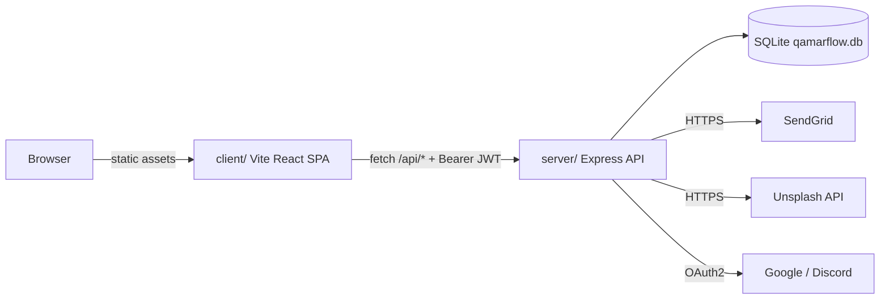
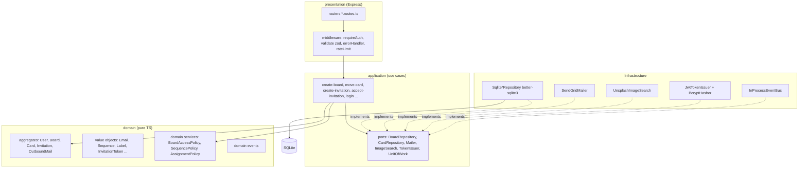
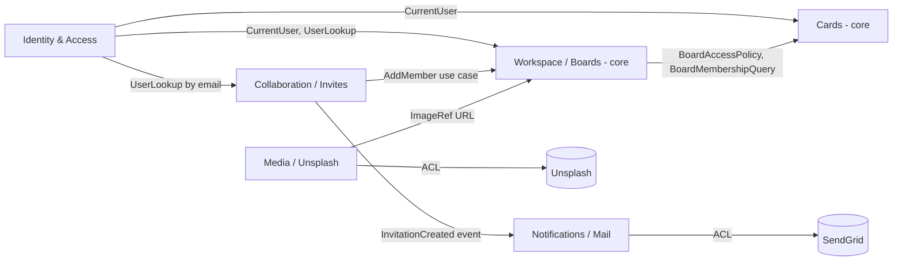
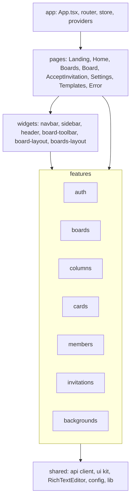
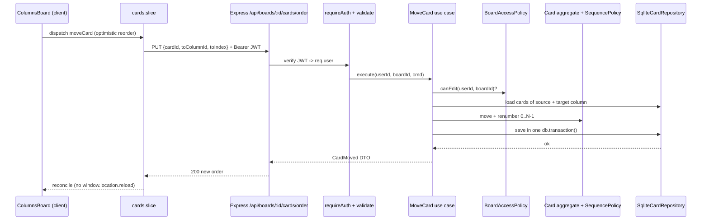
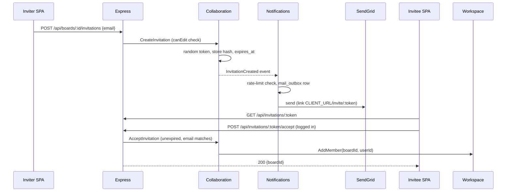
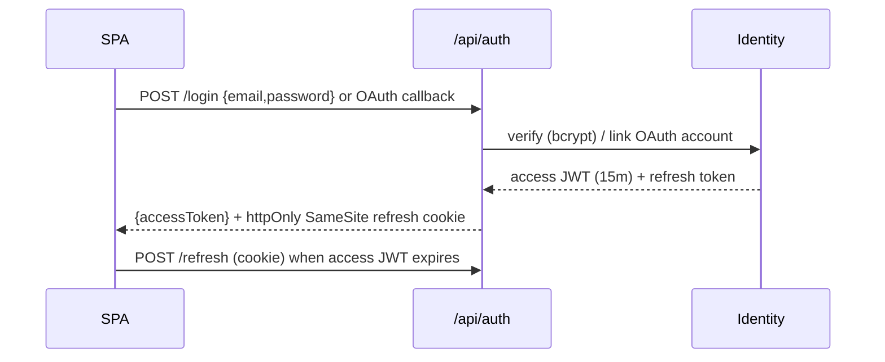

# QamarFlow target architecture

Vite + React SPA (`client/`) talks JSON over HTTP to an Express API (`server/`) backed by one SQLite file (`better-sqlite3`). Domains: [DOMAINS.md](DOMAINS.md). Tables: [DATA_SCHEMA.md](DATA_SCHEMA.md).

## 1. System context



## 2. Server: layered DDD per bounded context

Dependency rule: arrows point inward. Domain imports nothing from Express, SQLite or SDKs. Infrastructure implements ports declared in domain/application.



### Context relationships



## 3. Client: feature-sliced domains

Layers import downward only: `app → pages → widgets → features → shared`. A feature never imports another feature; widgets/pages compose them.



Each feature: `api/` (typed fetchers or RTK Query endpoints), `model/` (slice, selectors, types), `ui/` (components), `index.ts` (public surface).

## 4. Request flows

### Move a card (drag and drop)



### Invite and accept



### Auth (replaces next-auth)



## 5. Folder trees

### server/

```
server/
  package.json            express, better-sqlite3, jsonwebtoken, bcrypt, zod, @sendgrid/mail, unsplash-js, helmet, cors, express-rate-limit
  tsconfig.json
  .env.example
  scripts/
    migrate-from-mongo.ts
  src/
    index.ts               bootstrap: env, db, container, app.listen
    app.ts                express app: helmet, cors, json, routers, errorHandler, static client/dist
    config/
      env.ts              zod-validated env
    container.ts          wires ports to adapters (manual DI)
    shared/
      domain/             Id, Entity, AggregateRoot, DomainEvent, DomainError, Result
      application/        UnitOfWork, EventBus ports
      presentation/       errorHandler, validate(zod), asyncHandler
    infrastructure/
      db/
        schema.sql
        connection.ts     new Database(DATABASE_PATH), pragmas, exec(schema)
        unit-of-work.ts   wraps db.transaction()
      events/
        in-process-event-bus.ts
    domains/
      identity/
        domain/           user.ts, email.ts, password-hash.ts, oauth-account.ts
        application/      register.ts, login.ts, refresh.ts, logout.ts, oauth-callback.ts, get-user.ts, find-user-by-email.ts, ports.ts
        infrastructure/   sqlite-user.repository.ts, jwt-token-issuer.ts, bcrypt-hasher.ts, oauth/google.provider.ts, oauth/discord.provider.ts
        presentation/     auth.routes.ts, users.routes.ts, require-auth.middleware.ts, dto.ts
      workspace/
        domain/           board.ts, column.ts, membership.ts, board-access-policy.ts, sequence-policy.ts, events.ts
        application/      list-boards.ts, create-board.ts, get-board.ts, rename-board.ts, set-background.ts, delete-board.ts, add-column.ts, update-column.ts, delete-column.ts, reorder-columns.ts, add-member.ts, ports.ts
        infrastructure/   sqlite-board.repository.ts, sqlite-column.repository.ts
        presentation/     boards.routes.ts, columns.routes.ts, dto.ts
      cards/
        domain/           card.ts, label.ts, rich-text.ts, assignment-policy.ts, card-placement.ts
        application/      list-cards.ts, create-card.ts, update-card.ts, move-card.ts, delete-card.ts, ports.ts
        infrastructure/   sqlite-card.repository.ts, board-membership.query.ts
        presentation/     cards.routes.ts, dto.ts
      collaboration/
        domain/           invitation.ts, invitation-token.ts, events.ts
        application/      create-invitation.ts, verify-invitation.ts, accept-invitation.ts, ports.ts
        infrastructure/   sqlite-invitation.repository.ts
        presentation/     invitations.routes.ts
      notifications/
        domain/           outbound-mail.ts, templates/invitation.html.ts
        application/      send-invitation-mail.ts (event handler), mail-rate-limiter.ts, ports.ts
        infrastructure/   sendgrid.mailer.ts, sqlite-outbox.repository.ts
      media/
        domain/           image-ref.ts
        application/      search-backgrounds.ts, random-background.ts, ports.ts
        infrastructure/   unsplash-image-search.ts, picsum.provider.ts
        presentation/     media.routes.ts
  test/                   (per DECISIONS: unit tests live beside code as *.test.ts; Jest)
```

### client/

```
client/
  index.html
  vite.config.ts          proxy /api -> http://localhost:4000
  package.json            react, react-router-dom, @reduxjs/toolkit, react-redux, @chakra-ui/react, @hello-pangea/dnd, react-quill
  .env.example            VITE_API_URL
  public/
  src/
    index.tsx
    vite-env.d.ts
    app/
      App.tsx
      router.tsx          /, /home, /boards, /boards/:boardId, /invite/:token, /settings, /templates, *
      store.ts
      hooks.ts            useAppDispatch, useAppSelector
      ErrorBoundary.tsx
      providers/          ChakraProvider.tsx, StoreProvider.tsx
      styles/default.css
    pages/
      LandingPage.tsx  HomePage.tsx  BoardsPage.tsx  BoardPage.tsx
      AcceptInvitationPage.tsx  SettingsPage.tsx  TemplatesPage.tsx  ErrorPage.tsx
    widgets/
      navbar/ (Navbar.tsx, UserMenu.tsx)
      sidebar/Sidebar.tsx
      header/Header.tsx
      board-toolbar/BoardToolbar.tsx
      board-layout/BoardLayout.tsx
      boards-layout/BoardsLayout.tsx
    features/
      auth/          api/auth.api.ts  model/auth.slice.ts  ui/{AuthProvider,RequireAuth,LoginForm,LoginModal,WelcomeScreen,AccountSettings}.tsx
      boards/        api/boards.api.ts  model/{boards.slice,board.slice,types}.ts  ui/{BoardList,BoardView,BoardSettingsMenu,Templates}.tsx
      columns/       api/columns.api.ts  model/{columns.slice,types}.ts  ui/{ColumnsBoard,Column,AddColumnButton}.tsx
      cards/         api/cards.api.ts  model/{cards.slice,types}.ts  ui/{CardList,CardItem,CardDetailsModal,CardLabelsMenu}.tsx
      members/       api/members.api.ts  model/members.slice.ts
      invitations/   api/invitations.api.ts  ui/InviteMemberModal.tsx
      backgrounds/   api/backgrounds.api.ts  ui/{BackgroundDrawer,UnsplashPicker}.tsx
    shared/
      api/http.ts         fetch wrapper: base URL, Bearer token, 401 -> refresh -> retry
      config/env.ts
      ui/                 BrandLink.tsx, RichTextEditor.tsx
      lib/                ids.ts, dates.ts
```

## 6. Migration order

1. Scaffold `server/` with schema, connection, shared kernel, Identity (JWT) and `requireAuth`.
2. Workspace + Cards contexts with authorization and transactional reorder; Mongo migration script.
3. Collaboration + Notifications (event-driven mail, rate limit) and Media proxy.
4. Scaffold `client/` with Vite, move features slice by slice, point them at the new API.
5. Remove `app/`, `slices/`, `util/`, `hooks/`, `types/`, Next config; update Dockerfile and CI.
