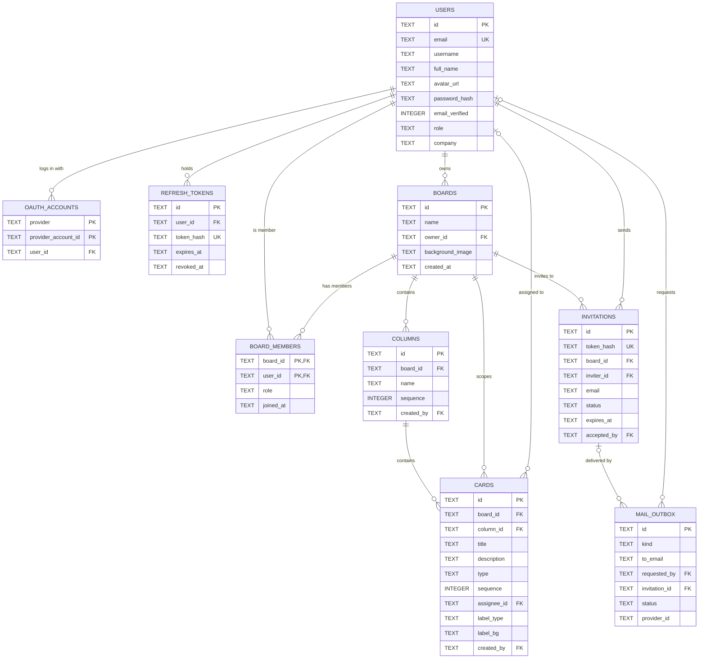

# QamarFlow data schema (SQLite)

Source of truth: `server/src/infrastructure/db/schema.sql`. Engine: SQLite via `better-sqlite3` (synchronous, WAL mode, `foreign_keys = ON`).

Derived from the Mongo collections the current code reads and writes (`users`, `boards`, `columns`, `cards`, `token`) in `app/api/**`, `slices/*.ts` and `types/*.ts`. Ids stay `TEXT` so existing `shortid` and OAuth provider ids migrate unchanged. Timestamps are ISO-8601 UTC strings.

## Mongo to SQLite mapping

| Mongo collection.field | SQLite table.column | Note |
| --- | --- | --- |
| `users._id` (providerAccountId) | `users.id` + `oauth_accounts.provider_account_id` | Provider id split out so one user can have several logins |
| `users.fullName / avatar / emailVerified` | `users.full_name / avatar_url / email_verified` | |
| — | `users.password_hash` | New: bcrypt hash for email/password login |
| `boards.createdBy` | `boards.owner_id` | |
| `boards.dateCreated` | `boards.created_at` | Was a locale string, now ISO |
| `boards.users[]` | `board_members` rows | Embedded array becomes a join table |
| `boards.columns?` (type only) | — | Dead field in `types/boards.ts`, dropped |
| `columns.columnName / userId` | `columns.name / created_by` | |
| `columns.boardName` | — | Denormalised copy dropped |
| `cards.assignedTo` (string) | `cards.assignee_id` | Single assignee, as in `types/cards.ts` |
| `cards.label {bg,type}` | `cards.label_bg, cards.label_type` | Value object flattened, both-or-neither CHECK |
| `cards.boardName / columnName` | — | Denormalised copies dropped |
| `token.token` | `invitations.token_hash` | Only the SHA-256 hash is stored |
| `token.userId / status / email / boardId` | `invitations.inviter_id / status / email / board_id` | Adds `expires_at`, `accepted_by`, `accepted_at` |
| — | `refresh_tokens`, `mail_outbox` | New: JWT rotation and mail audit / rate limit |

## Tables

### users
| Column | Type | Constraints |
| --- | --- | --- |
| id | TEXT | PK |
| email | TEXT | NOT NULL, UNIQUE, NOCASE |
| username | TEXT | NOT NULL |
| full_name | TEXT | NOT NULL default '' |
| avatar_url | TEXT | |
| password_hash | TEXT | NULL for OAuth-only users |
| email_verified | INTEGER | 0/1 |
| role | TEXT | default 'Employee' |
| company | TEXT | |
| created_at, updated_at | TEXT | ISO |

### oauth_accounts
| Column | Type | Constraints |
| --- | --- | --- |
| provider | TEXT | PK part, 'google' or 'discord' |
| provider_account_id | TEXT | PK part |
| user_id | TEXT | FK users, cascade |

### refresh_tokens
id PK, user_id FK users (cascade), token_hash UNIQUE, expires_at, revoked_at, created_at.

### boards
| Column | Type | Constraints |
| --- | --- | --- |
| id | TEXT | PK |
| name | TEXT | NOT NULL, 1..200 chars |
| owner_id | TEXT | FK users, cascade |
| background_image | TEXT | URL |
| created_at, updated_at | TEXT | |

### board_members
board_id FK boards (cascade) + user_id FK users (cascade) = composite PK; role ('owner' or 'member'); joined_at.

### columns
| Column | Type | Constraints |
| --- | --- | --- |
| id | TEXT | PK |
| board_id | TEXT | FK boards, cascade |
| name | TEXT | NOT NULL |
| sequence | INTEGER | >= 0, indexed with board_id |
| created_by | TEXT | FK users, set null |
| created_at, updated_at | TEXT | |

### cards
| Column | Type | Constraints |
| --- | --- | --- |
| id | TEXT | PK |
| board_id | TEXT | FK boards, cascade; trigger enforces it equals the column's board |
| column_id | TEXT | FK columns, cascade |
| title | TEXT | default 'Add title' |
| description | TEXT | Quill HTML, sanitised on write |
| type | TEXT | |
| sequence | INTEGER | >= 0, indexed with column_id |
| assignee_id | TEXT | FK users, set null |
| label_type, label_bg | TEXT | both or neither |
| created_by | TEXT | FK users, set null |
| created_at, updated_at | TEXT | |

### invitations
id PK, token_hash UNIQUE, board_id FK boards (cascade), inviter_id FK users (cascade), email, status ('pending','accepted','revoked','expired'), expires_at, accepted_by FK users, accepted_at, created_at. Partial unique index: one `pending` invite per (board_id, email).

### mail_outbox
id PK, kind ('board_invitation','verify_email'), to_email, requested_by FK users, invitation_id FK invitations, status ('queued','sent','failed'), provider_id, error, created_at, sent_at. Index (requested_by, created_at) backs the send rate limit.

## Relationships and cardinalities

| Relationship | Cardinality | On delete |
| --- | --- | --- |
| users → boards (owner) | 1 : 0..N | cascade |
| users ↔ boards via board_members | N : M | cascade both sides |
| boards → columns | 1 : 0..N | cascade (replaces broken `collection.remove()` in Mongo routes) |
| columns → cards | 1 : 0..N | cascade |
| boards → cards | 1 : 0..N | cascade (redundant key, kept for board-wide card query; trigger keeps it consistent) |
| users → cards (assignee) | 0..1 : 0..N | set null |
| users → oauth_accounts | 1 : 0..N | cascade |
| users → refresh_tokens | 1 : 0..N | cascade |
| boards → invitations | 1 : 0..N | cascade |
| users → invitations (inviter) | 1 : 0..N | cascade |
| invitations → mail_outbox | 0..1 : 0..N | set null |

## ER diagram

## Migration notes

- One-off script `server/scripts/migrate-from-mongo.ts` (proposed): read each collection, map per the table above, insert inside one `db.transaction()`.
- `dateCreated` values are `toLocaleString()` strings in Mongo; parse with a fallback to the migration time.
- `boards.users[]` entries that point to missing users are skipped and logged.
- Existing `token` rows have no expiry; migrate them as `expired` and let users re-invite.
- Sequences: renumber each column's cards and each board's columns 0..N-1 during migration to remove gaps and duplicates.
